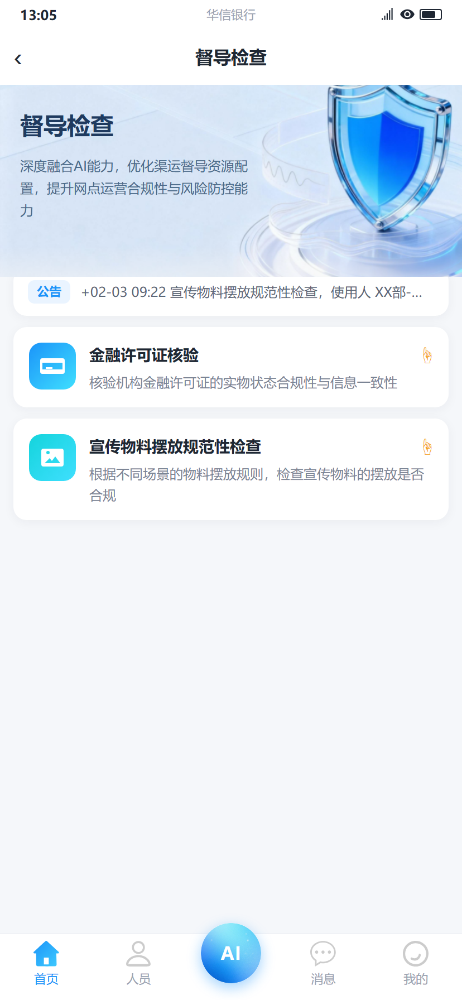
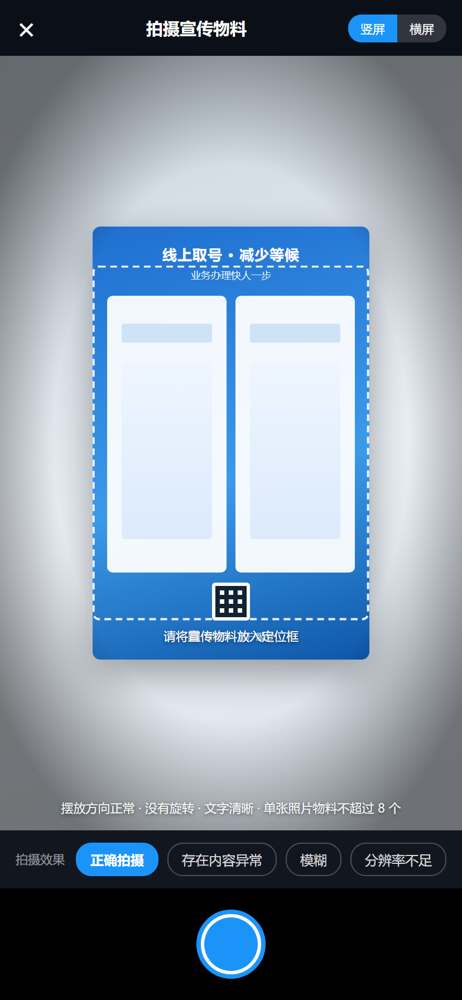
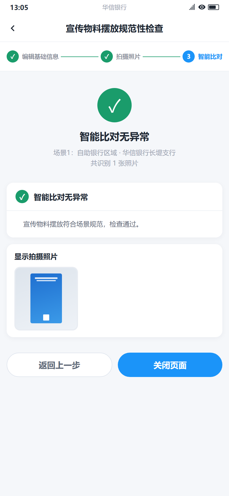
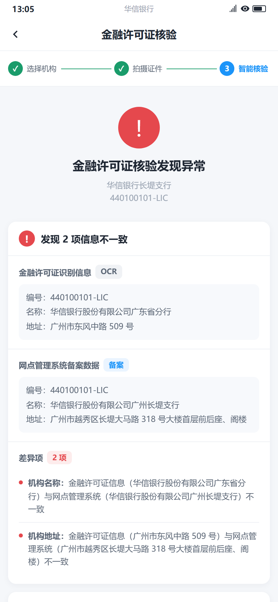

# 移动工作台 · Vue 3 + Flask

> 银行网点现场检查移动端应用，前后端分离重构版本：Vue 3（Vite）负责界面与交互，Flask 提供业务数据、检查校验与记录存储。

[](frontend)
[](backend)
[](frontend)
[](LICENSE)

<p align="center">
  
  
  
  
  
</p>

---

## 目录

- [项目简介](#项目简介)
- [技术架构](#技术架构)
- [目录结构](#目录结构)
- [快速开始](#快速开始)
- [API 文档](#api-文档)
- [业务逻辑说明](#业务逻辑说明)
- [部署](#部署)
- [常见问题](#常见问题)
- [许可](#许可)

## 项目简介

本应用模拟银行内控督导人员使用移动端完成网点现场检查的完整流程：

| 业务 | 说明 |
| --- | --- |
| **宣传物料摆放规范性检查** | 选择机构与场景 → 拍摄物料照片 → 服务端图像质量校验 → 按场景规则智能比对 |
| **金融许可证核验** | 选择机构 → 拉取网点管理系统备案数据 → 拍摄证件 → 服务端比对信息一致性 |

同时包含首页工作台、督导检查入口、我的、设置（岗位切换）、消息等模块。

> 机构、网点、人员、地址、备案数据均为示例数据；拍摄为界面内模拟，不调用设备摄像头。

## 技术架构

```
┌─────────────────────────────┐        ┌──────────────────────────────┐
│  浏览器（移动端视口）        │        │  Flask 3 / Python            │
│                             │  /api  │                              │
│  Vue 3 + Vue Router         │ ─────▶ │  REST 接口                    │
│  Vite 构建（生产 dist）      │        │  check_service：质量/比对逻辑  │
│  响应式 store（reactive）    │ ◀───── │  SQLite：检查记录持久化        │
└─────────────────────────────┘  JSON  └──────────────────────────────┘
```

- **前端**：Vue 3 组合式 API、Vue Router（history 模式）、原生 CSS（复用原型设计变量）、无 UI 组件库
- **后端**：Flask 3，按模块拆分为数据、校验服务、持久化三层
- **存储**：SQLite（`backend/instance/checks.db`），随项目运行自动创建
- **生产形态**：`vite build` 产出 `frontend/dist`，由 Flask 单端口同时托管静态资源与 `/api`

## 目录结构

```
vue-flask-app/
├── backend/
│   ├── app.py                # Flask 应用：API + 静态托管
│   ├── data.py               # 种子数据（机构树/场景/备案/课程等）
│   ├── check_service.py      # 质量校验与一致性比对逻辑
│   ├── db.py                 # SQLite 初始化与检查记录读写
│   ├── requirements.txt
│   └── instance/checks.db    # 运行时生成
├── frontend/
│   ├── index.html
│   ├── vite.config.js        # /api 代理到后端
│   ├── package.json
│   ├── .npmrc                # 依赖镜像源
│   ├── public/assets/        # 图标与插图（原样复用原型素材）
│   └── src/
│       ├── main.js
│       ├── App.vue           # 手机外壳、状态栏、路由出口
│       ├── router.js
│       ├── api.js            # fetch 封装
│       ├── store.js          # 全局状态 / Toast / Dialog
│       ├── styles.css
│       ├── components/
│       │   ├── TabBar.vue     CameraMock.vue   StepBar.vue
│       │   ├── OrgPicker.vue  ScenePicker.vue
│       │   └── AppDialog.vue  ToastBar.vue
│       └── views/
│           ├── HomeView.vue        InspectionView.vue
│           ├── MaterialView.vue    LicenseView.vue
│           └── MineView.vue        SettingsView.vue   MessagesView.vue
├── docs/screenshots/
├── scripts/start.ps1         # 启动逻辑（环境检测 + 按需构建 + 启服务）
├── start.bat / diagnose.bat  # Windows 双击入口
├── start.sh                  # Linux / macOS 入口
└── README.md
```

## 快速开始

### 环境要求

| 依赖 | 版本 |
| --- | --- |
| Node.js | ≥ 18 |
| Python | ≥ 3.9 |
| Flask | ≥ 3.0 |

### 1. 后端

```bash
cd backend
pip install -r requirements.txt
python app.py            # 默认 http://127.0.0.1:5000
```

> 若机器上有多个 Python，请使用**已安装 Flask 的那个解释器**，或先执行 `pip install flask`。

### 2. 前端开发模式

```bash
cd frontend
npm install
npm run dev              # http://127.0.0.1:5173 ，/api 自动代理到 5000
```

### 3. 生产一体化（单端口）

```bash
cd frontend && npm install && npm run build
cd ../backend && python app.py
# 访问 http://127.0.0.1:5000
```

或直接使用启动脚本：

| 系统 | 操作 |
| --- | --- |
| **Windows** | **双击 `start.bat`**，自动查找带 Flask 的 Python、按需构建前端并启动；失败时窗口会停住显示原因 |
| Windows（仅检查环境） | 双击 `diagnose.bat`，输出 Node / Python / Flask / 构建产物检测结果 |
| Linux / macOS | `./start.sh`（可用 `PYTHON=/path/to/python` 指定解释器） |

> Windows 下请**双击 `start.bat`**，不要在终端里敲 `./start.sh`（那是 Linux/macOS 的写法）。
> 启动脚本会依次尝试 `PYTHON` 环境变量、`python` 命令、`C:\Program Files\python*\`、用户目录下的 Python，并挑选**能 import flask** 的那个。

### 手机预览

手机与电脑同一局域网，访问 `http://<电脑IP>:5000`，可在浏览器菜单中「添加到主屏幕」。

## API 文档

| 方法 | 路径 | 说明 |
| --- | --- | --- |
| GET | `/api/health` | 健康检查 |
| GET | `/api/bootstrap` | 首屏全量数据（品牌、用户、岗位、宫格、课程、公告、消息、任务、机构树、场景、拍摄效果） |
| GET | `/api/orgs` | 机构树 |
| GET | `/api/scenes` | 检查场景列表 |
| GET | `/api/scenes/<scene_id>` | 单个场景详情 |
| GET | `/api/license/records/<org_code>` | 网点备案数据 |
| GET | `/api/messages` | 消息列表 |
| GET | `/api/notices` | 公告列表 |
| POST | `/api/quality/material` | 宣传物料照片质量校验 |
| POST | `/api/quality/license` | 金融许可证照片质量校验 |
| POST | `/api/checks/material` | 提交物料检查（含智能比对） |
| POST | `/api/checks/license` | 提交许可证核验（含一致性比对） |
| GET | `/api/checks?limit=20` | 检查记录与统计 |

### 请求示例

**提交物料检查**

```bash
curl -X POST http://127.0.0.1:5000/api/checks/material \
  -H "Content-Type: application/json" \
  -d '{"org":{"code":"440100101","name":"华信银行长堤支行"},"sceneId":"scene2","photos":[{"effect":"normal","ratio":"portrait"}]}'
```

```json
{ "quality": { "ok": true, "messages": [] }, "anomalies": [], "result": "pass", "photoCount": 1 }
```

**提交许可证核验**

```bash
curl -X POST http://127.0.0.1:5000/api/checks/license \
  -H "Content-Type: application/json" \
  -d '{"org":{"code":"440100101"},"photos":[{"effect":"mismatch"}]}'
```

```json
{
  "quality": { "ok": true, "messages": [] },
  "record": { "code": "440100101-LIC", "name": "华信银行股份有限公司广州长堤支行", "address": "广州市越秀区长堤大马路 318 号大楼首层前后座、阁楼" },
  "ocr": { "code": "440100101-LIC", "name": "华信银行股份有限公司广东省分行", "address": "广州市东风中路 509 号" },
  "diffs": [ { "field": "机构名称", "ocr": "...", "record": "..." } ],
  "result": "anomaly"
}
```

### 照片 effect 取值

| 取值 | 含义 | 服务端行为 |
| --- | --- | --- |
| `normal` | 正确拍摄 | 质量通过，无异常 |
| `content` | 存在内容异常（物料） | 质量通过，按场景规则检出异常 |
| `mismatch` | 信息不一致（许可证） | 质量通过，构造与备案数据不一致的识别结果 |
| `blur` | 模糊 | 质量不通过，拦截下一步 |
| `lowres` | 分辨率不足 | 质量不通过，拦截下一步 |

## 业务逻辑说明

- **图像质量校验**：`check_service.material_quality` / `license_quality` 依据拍摄效果判定；模糊与分辨率不足会阻止进入比对步骤。
- **内容异常判定**：仅当照片标记为 `content` 时，按所选场景的识别规则（二维码、连续数字、电话关键字、材料名称不符等）返回异常清单。
- **一致性比对**：`license_compare` 将识别结果与备案数据在机构编号、名称、地址三项逐项比对，输出差异列表。
- **记录持久化**：每次提交写入 `checks` 表（类型、机构、场景、结果、照片数、明细、时间），可通过 `/api/checks` 查询。

## 部署

### 单端口（推荐）

构建前端后由 Flask 统一托管，仅暴露一个端口，适配各类 PaaS：

```bash
npm --prefix frontend install && npm --prefix frontend run build
PORT=8000 python backend/app.py
```

服务需监听 `PORT` 环境变量（已实现，默认 5000），绑定 `0.0.0.0`。

### 分离部署

- 前端 `dist` 可托管到任意静态站点（需配置 history 路由回退到 `index.html`），构建时通过 `API_TARGET` 或反向代理指向后端
- 后端单独运行 `python backend/app.py`，前置 Nginx 转发 `/api`

## 常见问题

<details>
<summary>Windows 双击 start.bat 一闪而过（闪退）</summary>

常见原因与处理：

1. **默认 `python` 没装 Flask** —— 最常见。脚本会在最后一步 `python app.py` 立即报 `ModuleNotFoundError: No module named 'flask'` 并退出，窗口随之关闭。
   处理：`pip install -r backend/requirements.txt`，或让脚本使用已装 Flask 的解释器（设置环境变量 `PYTHON` 指向它）。
2. **Node.js / npm 未安装** —— 脚本会在构建前端时报错退出。
   处理：安装 Node.js 18+ 后重开窗口。
3. **端口被占用** —— 换个端口启动：先 `set PORT=5001` 再运行。

新版启动器已修复上述体验：

- 启动失败时窗口会**停住**并显示 `[FAILED]` 与具体原因（不再闪退）
- 自动遍历候选 Python，选择**能 import flask** 的解释器
- 前端 `dist` 已存在时跳过构建，启动更快

排查命令（输出环境检测结果）：

```
双击 diagnose.bat
```

或在命令行执行：

```bat
powershell -NoProfile -ExecutionPolicy Bypass -File scripts\start.ps1 -CheckOnly
```

</details>

<details>
<summary>启动后页面空白 / 提示"前端尚未构建"</summary>

需要先执行 `cd frontend && npm run build` 生成 `dist`，再启动 Flask。

</details>

<details>
<summary>npm install 失败或很慢</summary>

`frontend/.npmrc` 已配置国内镜像。若仍失败，检查网络或改用 `npm install --registry=https://registry.npmmirror.com`。

</details>

<details>
<summary>ModuleNotFoundError: No module named 'flask'</summary>

当前使用的 Python 解释器未安装 Flask。执行 `pip install -r backend/requirements.txt`，或切换到已安装 Flask 的解释器。

</details>

<details>
<summary>刷新子路由（如 /material）出现 404</summary>

Flask 已实现 SPA 回退；若使用 Nginx 等前置服务器，需将未知路径回退到 `index.html`。

</details>

## 许可

[MIT License](LICENSE)
